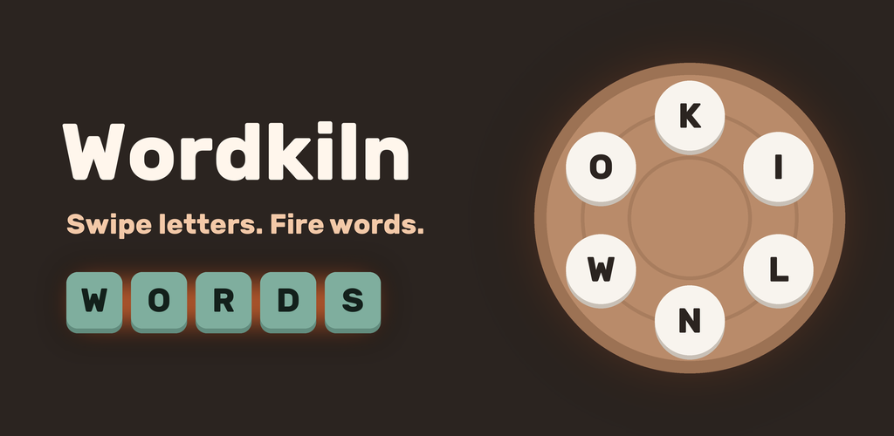
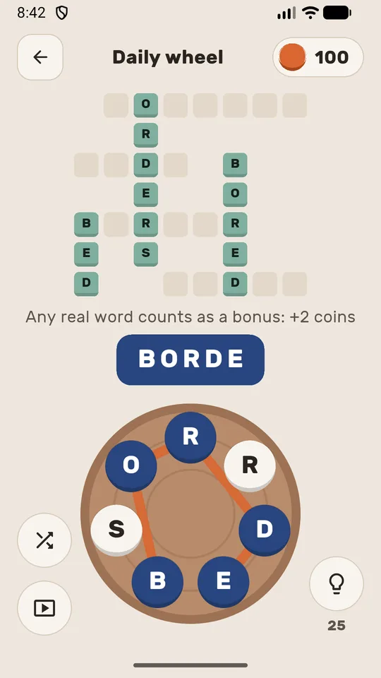
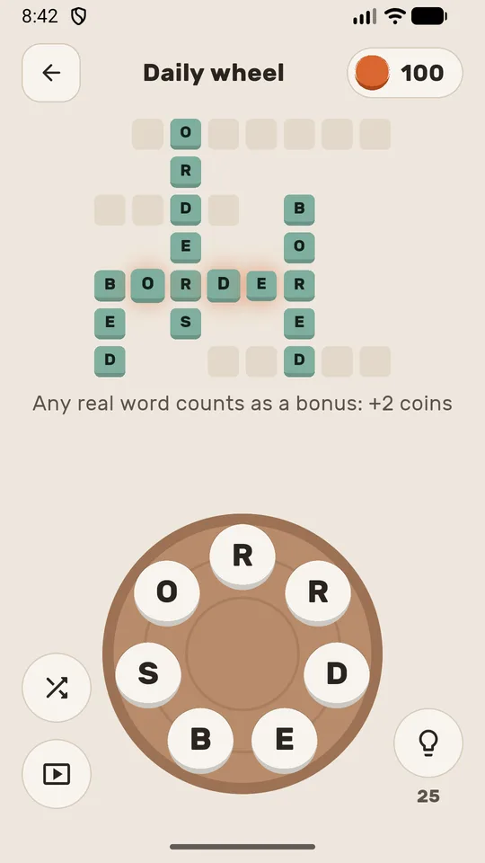
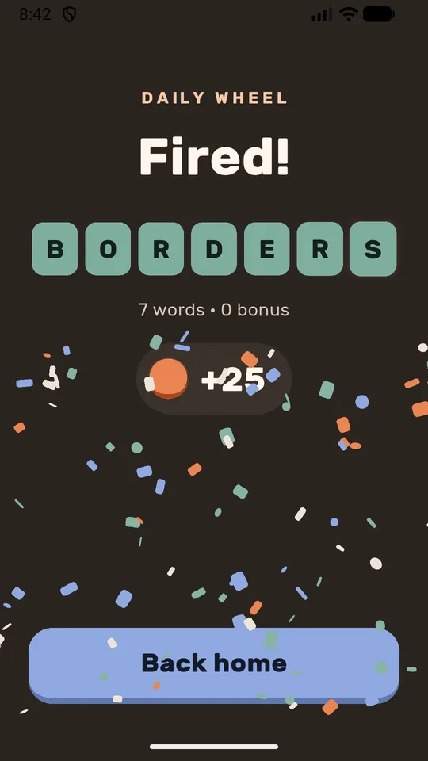

# Wordkiln: Word Connect Puzzle

A free word connect puzzle for Android: swipe letters on a potter's wheel, fill the crossword, and every real word you find counts.

[**Get it on Google Play**](https://play.google.com/store/apps/details?id=com.wordkilngame.wordkiln&utm_source=github&utm_medium=readme)

  
  
  

## What it is

Wordkiln is a calm word game. Drag across the letters on the wheel to spell words; each answer fires into the crossword above like a tile fresh from the kiln. It opens straight to your next level, with no pop-up maze, card packs or countdown clocks.

## Features

- **Word connect gameplay**: swipe to spell, slide back to undo, shuffle the wheel.
- **Every real word counts**: words that aren't on the board are bonus words and pay coins.
- **Grows with you**: wheels go from three letters to seven, with bigger crosswords.
- **Daily wheel**: a new seven-letter puzzle every day.
- **Fair hints**: one letter for 25 coins, never used unless you ask.
- **Daily check-in** coins and an optional evening reminder.
- **Plays offline**, no account, no sign-in.
- **Light and soft dark mode**, respects reduce-motion.
- **Free**, supported by ads. No in-app purchases.

## Links

- Website: <https://wordkiln.pages.dev/>
- Privacy policy: <https://wordkiln.pages.dev/privacy/>
- Trailer: <https://youtu.be/BNjxqHJU-gs>
- Product page: <https://nookeshkarri7.github.io/wordkiln-word-connect-puzzle/>
- Contact: anithabheesetty@gmail.com

More apps from the same developer: [NK Tools on Google Play](https://play.google.com/store/apps/developer?id=NK+Tools).
